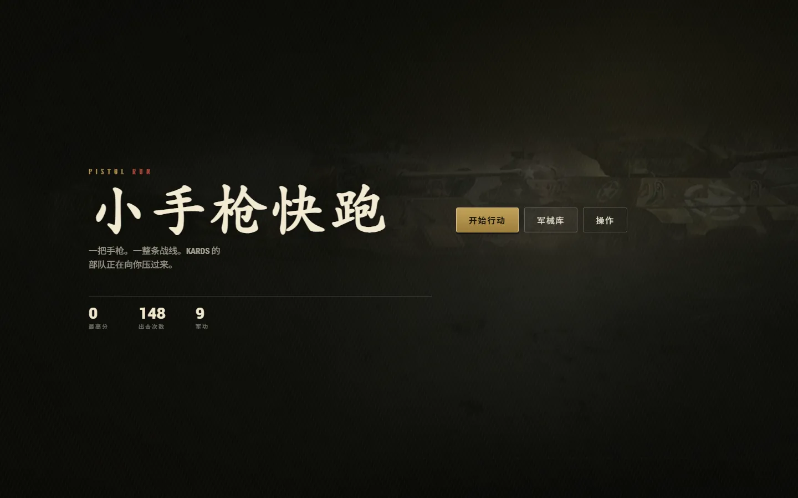
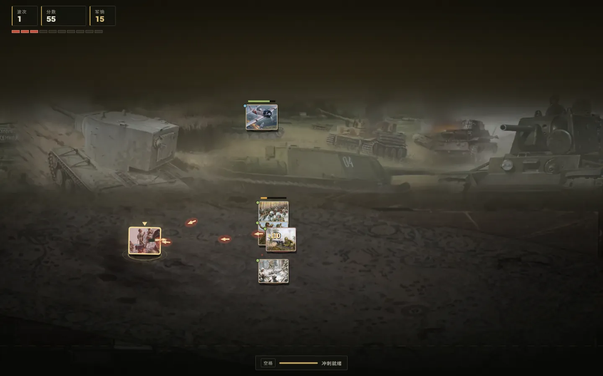
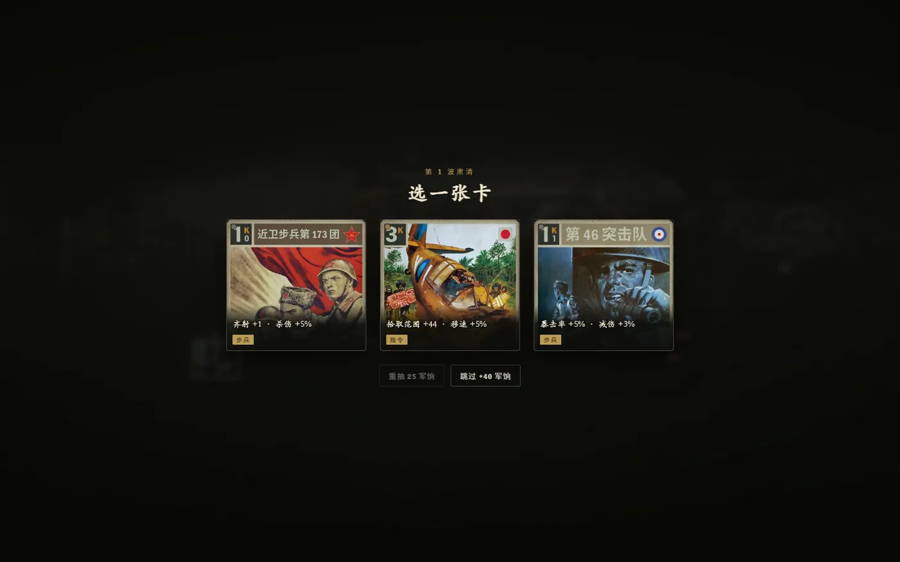
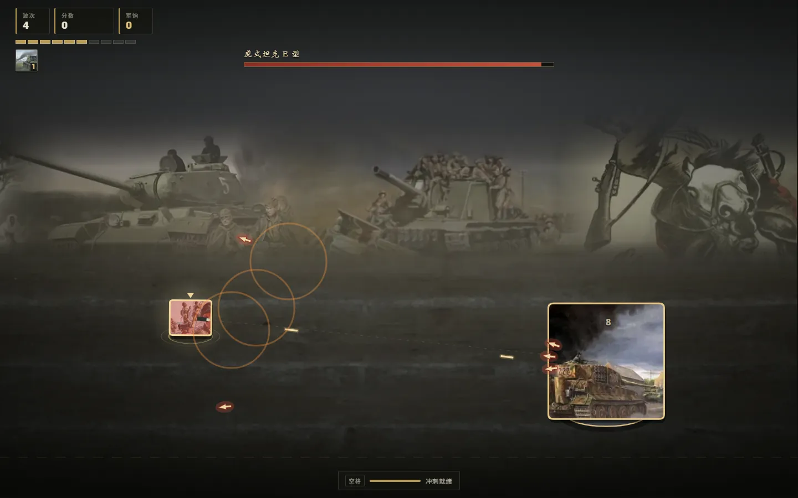
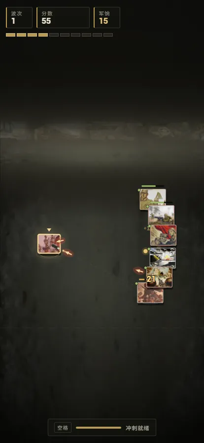
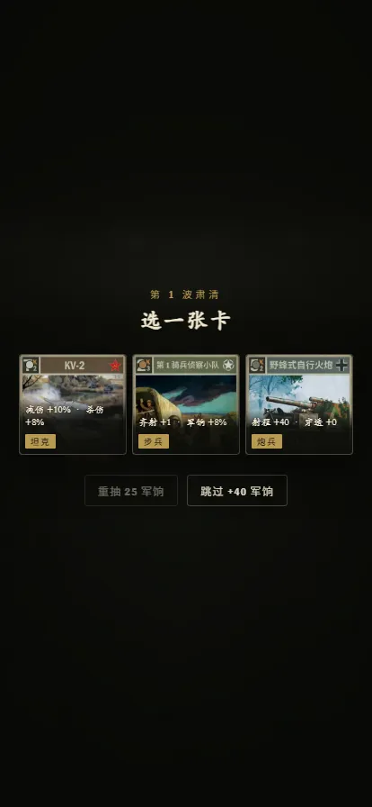

# 小手枪快跑 · Pistol Run

**用 KARDS 的卡牌打出一条血路。** 一款单屏自动射击肉鸽，素材 100% 取自 KARDS 官方卡牌。

🎮 **在线试玩**：https://flominfloden.github.io/Pistol-Run/



---

## 这是什么

从《箭箭剑 Arrow a Row》拆包还原的「自动射击 + 三选一肉鸽」框架，重新做成一款 KARDS 主题的射击游戏。

你操控**第 10 突击队**——KARDS 卡面上那位举着手枪的战士。手枪自动锁定并开火，你只需要走位、冲刺、躲弹幕，然后在每波结束时从 3 张 KARDS 卡里选 1 张变强。

- **敌人**：T-34、虎式、KV-2、丘吉尔、喷火、零战、B-17、喀秋莎……全是 KARDS 卡牌
- **强化**：每波结束抽 3 张 KARDS 卡选 1 张，共 51 张进池
- **Boss**：每 4 波一次，虎式 / 俾斯麦 / 虎王 / 大和 / 203 榴弹炮轮换
- **局外成长**：结算获得军功，在军械库兑换 8 项永久强化



## 玩法

| 操作 | 说明 |
|---|---|
| WASD / 方向键 / 拖动屏幕 | 移动 |
| 空格 / Shift / 轻点屏幕 | 冲刺（0.28 秒无敌，冷却 2.4 秒） |
| — | 手枪自动锁定并开火，无需点击 |

- 每波肃清后进入**三选一**，可重抽（消耗军饷）或跳过（+40 军饷）
- 分数越高、波次越深，结算获得的**军功**越多
- 军功在**军械库**兑换永久强化，跨局继承



## 卡牌如何变成强化

每张 KARDS 卡按「兵种 → 强化方向」「稀有度 → 强化档位」「国家 → 附加词条」生成效果：

| 兵种 | 强化方向 |
|---|---|
| 步兵 | 射速 / 齐射 / 暴击率 |
| 坦克 | 生命上限 / 减伤 / 齐射 |
| 炮兵 | 杀伤 / 爆破 / 射程 |
| 战斗机 | 移速 / 冲刺冷却 / 弹速 |
| 轰炸机 | 僚机 / 穿透 / 弹速 |
| 指令 | 军饷 / 缴获生命 / 拾取范围 |

稀有度倍率：标准 1.0 / 限定 1.28 / 特殊 1.62 / 精英 2.1



## 响应式

单屏竞技场，世界尺寸按画幅比例生成：横屏 900 高、竖屏 560 宽，等比铺满不拉伸。背景也分横竖两版。

| 竖屏战斗 | 竖屏选卡 |
|---|---|
|  |  |

## 运行

```bash
# 开发
pnpm install
pnpm dev

# 构建
pnpm build

# 预览构建产物（必须是 http 服务，不能直接双击 index.html）
python -m http.server 5199 --directory dist
```

## 技术栈

原生 Canvas 2D + 原生 ES Module，无游戏引擎、无 UI 框架。构建只依赖 Vite。

```
pistol-run/
├── index.html
├── vite.config.js
├── assets/                 # 静态资源（Vite publicDir）
│   ├── art/                # 单位原画（从卡面裁出）240×188 WebP
│   ├── faces/              # 完整卡面 320×449 WebP
│   ├── draft/              # 选卡卡面（裁掉规则文本区）340×320 WebP
│   ├── bg/                 # 战场背景，横版 2560×1000 / 竖版 1080×1920
│   ├── sfx/                # KARDS 游戏内音效，Opus
│   └── fonts/              # KARDS 卡面字体
├── src/
│   ├── main.js             # 流程编排、状态机、主循环
│   ├── style.css
│   ├── core/
│   │   ├── game.js         # 玩法引擎：移动、射击、敌人 AI、Boss、波次
│   │   ├── renderer.js     # Canvas 渲染：背景、单位、弹道、特效
│   │   ├── input.js        # 键盘 + 触摸 + 拖拽
│   │   ├── assets.js       # 图片预加载与缓存
│   │   ├── audio.js        # WebAudio 音效池
│   │   └── save.js         # localStorage 存档与局外强化
│   ├── data/
│   │   ├── cards.js        # 81 张 KARDS 卡 + 强化生成规则
│   │   └── enemies.js      # 敌军阵容与 Boss 表
│   └── ui/
│       ├── hud.js          # HUD、血条、冲刺条、Boss 血条
│       └── draft.js        # 三选一卡牌界面
└── dist/                   # 构建产物（GitHub Pages 直接托管）
```

## 数值调优笔记

这些都是实测出来的，不是拍脑袋：

- **射程下限绑定世界宽度（0.94×W）**：不然刚出生的敌人在射程外，第一波 9 秒只打死 1 个
- **目标粘滞 0.55 秒**：不然瞄准会在多个敌人间来回跳（实测 aim 从 −1.63 跳到 −0.01 再跳到 −0.53），几乎全是空枪
- **分道生成 + 单位分离**：不然同一批敌人完全叠在一起，看起来像一张卡
- **波次预算随波数增长（9 + 2.2×波数）**：保证后期场上始终有压迫感

调完后 14 秒能杀 9 个敌人，场上保持 1–8 个敌人。

## 素材说明

卡牌数值与中文文本来自 KARDS 官方卡牌数据（1646 张全量，本作选用 81 张）。卡面、原画、战场底板、音效、字体版权归 **1939 Games** 所有，本项目仅作玩家交流与学习用途，不作商业使用，与游戏厂商无隶属关系。

## 致谢

- **KARDS** — 1939 Games，所有美术与音效素材的来源
- **箭箭剑 Arrow a Row** — 玩法框架的灵感与拆包参考
